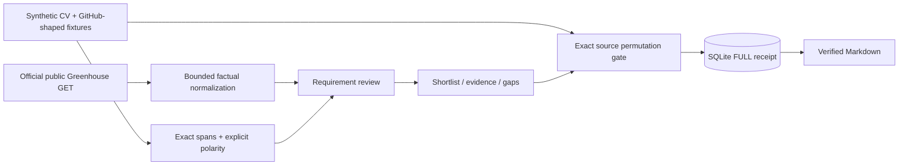

# Fit

## 1. Problem
Job matching hides its reasoning, and resume tailoring can introduce claims absent from the source CV.

## 2. Result
72 agent-authored synthetic development judgments: evidence policy nDCG@5 0.970 versus TF-IDF 0.799; independent human validation **not measured**.
72 source-only variants verified across 6 profiles and 12 jobs.
1000/1000 altered-text negative controls rejected; source truth and hiring outcomes **not measured**.

## 3. Architecture


## 4. Run it
```sh
make demo
make lint test bench
make feed
```
Open http://127.0.0.1:18124. Demo installs locked dependencies and builds; Node 22.13+ required. Default edit token local-edit is for loopback only. Feed is optional and uses a public GET; the default demo is offline after setup. See [demo](docs/DEMO.md).

## 5. Decisions and limits
**Partial:** independent human-ranked evaluation is missing. Frozen agent-authored development labels are subjective and are not held-out validation. See [raw results](docs/results/benchmark.json), including per-profile losses. Baseline uses full-posting TF-IDF cosine; policy uses recognized requirement skills, required weight 1, preferred 0.25, and a linear experience factor. No training, outcome calibration or hiring-probability claim.

Only synthetic CV and GitHub-shaped records are accepted; a synthetic marker is a format constraint, not a privacy detector. Repository language metadata is a hint, never authorship/proficiency evidence. Skill negation is a conservative whole-line heuristic, not semantic entailment. Requirements use headings and lexical aliases; extraction accuracy on public jobs is not measured. Unsupported clauses need manual review. Alternative clauses and years are approximate.

Variants are complete permutations of exact original bullets; no paraphrasing, generated achievements, added metrics or PDF export. SHA256 and UTF-16 spans bind them to the source; this checks integrity, not truth. Successful writes are acknowledged after SQLite commit; single-process local storage, no HA/power-loss claim. Shared edit token, no per-user tenancy. Synthetic source text is visible to local viewers.

The exact career-ops-juiced directory was absent. Fit extends a reviewed MIT-licensed extractor from the related public career-ops fork; no personal CV/config imported. [Provenance](docs/results/reuse-provenance.json), [license](vendor/career-ops/LICENSE), [design](DESIGN.md). Existing repositories were preserved.

Public postings come only from the [official Greenhouse public Job Board API](https://docs.greenhouse.io/job-board). The bundled historical snapshot retains factual normalized skill metadata and hashes, not raw description prose; no scraping or applications. Company names identify public sources, not users or sponsors. [Fetch receipt](docs/results/public-feed-provenance.json).

The UI is an original cobalt/acid editorial shortlist; source-value rows were informed by the [GOV.UK summary-list pattern](https://design-system.service.gov.uk/components/summary-list/). No third-party visual assets copied. Docker/Render configuration is preparation, not a hosted availability claim.

## 6. Next
Independent blinded relevance labels and held-out roles; richer clause/negation parsing; consented private local import; authenticated per-user storage; accessible manual usability study; no autonomous applications.
